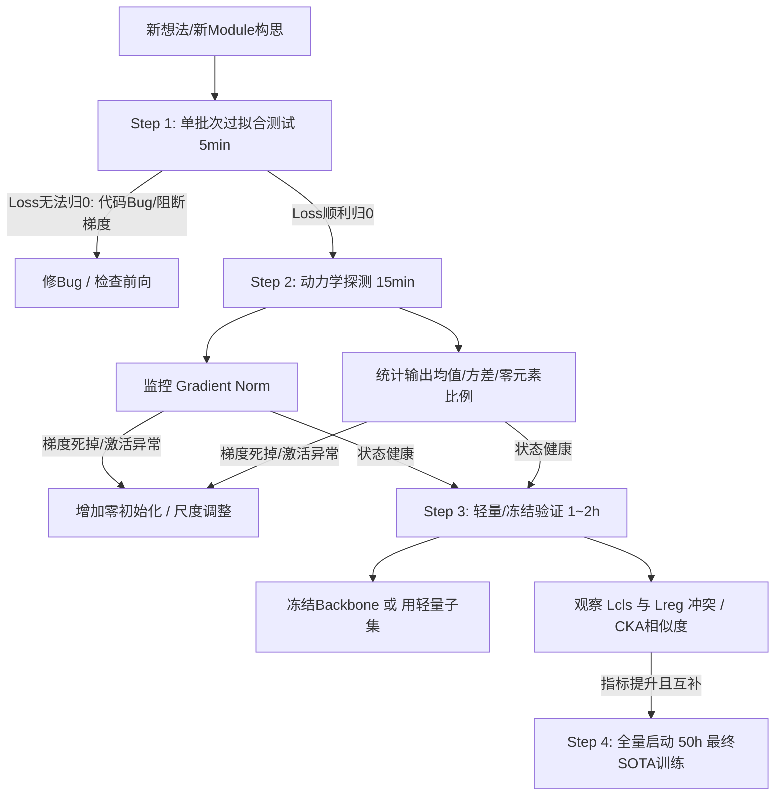
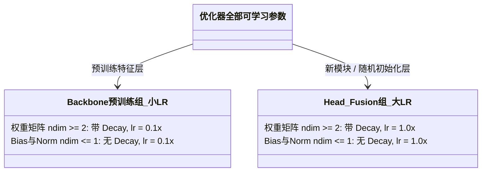
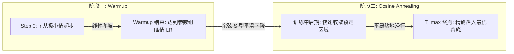

# 解构深度学习、神经网络

 以下的全是一些问题和思想，有些问过Gemini解答过了，但是我只稍微过了一遍解答，其中2、4、5、6、8、9问过Google的Gemini

## thinking plus problem

1.实质就是我们提出一种算法使得机器自己去学习和训练，按照我们所设计的架构（方式）。可不可行？要做了实验跑了才知道，只不过是说效果好坏差距罢了。只要你提出的学习（训练）方式合理，且在不违背你目前实验平台的复杂度（空间复杂度和时间复杂度，即存储、算力）情况下，一般来说实验都能跑出来，且结果不会太差，当然也和数据有很大关系，要根据数据自己去权衡。毕竟在“大数据”的情况下，我们都是频率学派，直接最大似然，而不是使用贝叶斯方法。

2.那也就是我们人工设计的架构不一定是一个好的学习架构，也不一定是一个不好的架构，只有经过学习训练多次实验之后才能知道这个架构是否好是吧。之后如果实验结果是有明显的改进，那就用一些可解释的话语强行往设计的架构上靠拢是吧？

3.“人工架构”设计的目的，不是让模型“变聪明”，而是帮它“少走弯路”。

4.等一下，我还有个疑问，就算人工设计了一种新的架构、方式或者方法，但也不一定能完美使用一模一样的代码实现是吧。那我们按照自己的人工设计实现代码一般是怎么实现的？比如，既然有注意力机制这个方式约束模型去训练学习，那我自己还想到了一个让模型更专家化的方法，基于“爱好、兴趣”机制的方式去训练学习，那我一般怎么实现呢？

5.大模型AI有计算能力吗？有记忆能力吗？他不是预测下一个词的概率之后随机挑选一个概率较高的词吗？

6.为什么我自己想出的问题，之后后面我从网上、ai或者自己已经想到了答案，但是过不了一会又忘了。那我学习相当于没学习呀，问题也还是没有解决呀。

7.主动回忆。如果你只是“看”了一遍答案（前向传播），你只是在消耗能量。 只有当你尝试“写”出来、或者“教”给别人时，你才是在进行 **误差反向传播（Backpropagation）**。这个过程会强迫你大脑中的神经元连接发生实质性的物理改变，去更新我的大脑权重参数。

8.我的想法是，AI能够像我们人类一样拥有实实在在的记忆能力，这样每次问你问题时你能从你自己的存储器里面检索答案，并能够把答案或者类似的问题拿出来进行推理。因为你的本质还只是进行预测概率较高的几个词，并从中随机挑选，我想如果你有记忆能力了，以及计算能力了，或许就能离我们人类更进一步了吧。

9.还有一个疑问。那就是学习深度学习与神经网络时，对于我这样使用AI来解决计算机视觉的问题的，最重要的不是他的可解释性与数学原理式子（因为或许都不会有数学原理，笑死），最重要的是设计的一个思想个代码实现，唯有这两个才是真正贯穿始终，有道理吗？

10.为什么不使用RAG技术（检索增强）技术来实现视觉模型、视觉语言模型的对SAR图像解译呢？我认为我这个是好主意。目前我的思想是，因为RAG技术可以做一个知识库，之后AI可以在这个知识库里面检索，所以我们可以放入专家知识，专业领域知识，目标知识，地理位置，场地，之后一起作用输出结果。刚看了以下RAG技术，但是我认为RAG技术还是一点不类似我们人类大脑的存储功能，看来离我所说的记忆能力还是基本没有呢，应该是吧？

11.不对，我总觉得使用transformer来处理图像（ViT）还是有信息损失，因为计算我们加了位置编码又怎么样？AI自己寻找规律他也不清楚这个是位置编码，毕竟可解释性太低了，他也只是知道往某个方向调整权重能够减少损失（所以往某个规律上靠拢）。Gemini告诉我，Swin-Transformer就是为了解决我所提到的空间连续性损失。

12.矩阵与图，随机过程表述为矩阵的连续乘积。

13.推理时改进模型，我的意思是现在大模型已经很强了，但是推理逻辑输出阶段，改进他的推理方式，可以像构建AIagent那样，让他按照一定的反馈循环式推理输出，逻辑推演输出。

14.所以我们在实现神经网络深度学习时，最重要的是我们写的一些显示式子约束（比如类似注意力机制的Q，K，V运算），与定义一个好的损失函数，只有这两个最重要是吧。对于神经网络的实现。对于显示约束（网络的架构设计）和损失函数（目标导向）的设计是最重要的。但是也请不要低估了一切的始作俑者“数据”，我们不是神，没有上帝视角，只能使用“数据”来发掘背后的真相（可能包含物理世界的真实规律和结构性），最后也关注一下优化方法，万一我设计了训练不出来不就炸了吗。

15.如何把因果推断加入AI训练当中，哦，不对，推理当中实现应该是最简单的。

16.详细展开讲讲这个“CLIP”模型的对称交叉熵损失，我明白你说的物理意思是计算相似度矩阵，之后相似度矩阵对角线上的元素值必须要最大，其他元素最小，但是数学式子怎么表示，以及代码是怎么写的呢？你只描述了一个很粗浅的物理意思，但是这种东西就是因为太过于显而易见，会让人觉得简单，结果马上就会忘了，因为真正的理解是物理显示意义、物理实现和数学式子都要完成理解，才是真正的理解。我认为造成我眼高手低的情况就是这样，就算我有诸多想法和设计，但是如果所了解的数学基础过于少，编程不会，那也就实现不了。

17.不行，我还是想自己手打一遍神经网络（from scratch DL），手写一个类似pytorch的库，具有误差方向传播、Transformer等等。

18.突然想搞一个类似excel这样可视化能跑神经网络的软件，excel对数据的处理太慢了，虽然能跑神经网络，但是体验很差。这样玩玩网络还是可以的。

19.我认为，不管你的神经网络模型有多复杂，核心最应该开始关注的是前向传播逻辑、张量维度和信号流向。训练的时候无非再就是加一个损失函数。所以下次我们可以直接叫AI帮我们分析论文的时候，自己先去看一下论文的网络架构图，再叫AI直接使用pytorch伪代码把模型的网络架构造出来，每一行代码都必须标注张量的形状，仔细查看信号的流向。

# Alchemy

记录自己的一些深度学习炼丹技巧

## 第一部分：如何高效做深度学习实验？（How to do experiment efficiently with deep learning?）

### 1. 高效排错与验证流程（1~8 步）

1. **单批次过拟合测试**（极速验证代码是否存在低级 Bug）。
2. **对新 Module 使用梯度范数监测**，查看是否发生梯度弥散或梯度爆炸。
3. **统计新 Module 输出的均值、方差以及“0”元素的比例**。
4. **CKA (Centered Kernel Alignment) 特征相似度分析**：用 CKA 分析加入 Module 前后的 Feature Map。
5. **$\mathcal{L}_{cls}$ 与 $\mathcal{L}_{reg}$ 观察分析**：查看是否发生“任务冲突”（Gradient Conflict），一般表现为 $\mathcal{L}_{cls} \downarrow$ 但 $\mathcal{L}_{reg} \uparrow$。
6. **类似 YOLO 训练完成后的可视化**：最终训练结果分析，如混淆矩阵（Confusion Matrix）等。
7. **使用 CAM 热力图分析**（验证注意力是否聚焦在目标区域）。
8. **若改进的是“Neck”与“Detection Head”**：可以直接冻结 Backbone 的预训练权重，只训练 Neck / Head。

#### 流程图：高效实验敏捷验证漏斗

### 2. 模块与模型改进的核心准则

* **“对模块”采用 0 初始化 $\to$**
  1. **分层学习率参数组**。
  2. **对 Plug and Play（即插即用模块）采用“零初始化”**。
  3. **对于 Transformer**：因缺乏归纳偏置，必须依赖 **AdamW**、**Grad Clip（梯度裁剪）**以及**更长的 Warmup**。
  4. **对于新做的改进**：审查是否存在**梯度流**和**尺度（Scale）**问题。
  5. **对模块零初始化时，只对该模块的最后一层权重和偏置置0或者使用ReZero在末尾乘上一个初始为0的可学习标量**，$$y = x + \alpha \cdot \text{NewModule}(x), \quad \text{其中 } \alpha \text{ 初始设为 } 0$$

## 第二部分：参数分组与权重衰减（Weight Decay 过滤规则）

### 1. 分层学习率参数组定义

* **定义**：根据网络不同层级所处的状态，分配不同的学习率和权重衰减（Weight Decay）。
* **把新 Module 放到“大学习率”参数组中**（基准学习率 $1.0\times$）。
* **Weight Decay 的数学本质**：会强制要求每轮更新参数时，强制把参数往“0”的方向拽一下。
* **铁律**：对偏置（Bias）、归一化层（Norm）以及嵌入编码表示（Embed）**不要进行 Weight Decay**。

### 2. 经典 $2 \times 2 = 4$ 参数组分类

* **按维度判定是否加 Weight Decay**：
  * **维度 $\ge 2$ 的参数**：
    * 卷积核为 4 维：$(C_{out}, C_{in}, K_h, K_w)$
    * 全连接权重为 2 维：$(C_{out}, C_{in})$
    * **角色**：核心权重矩阵 $\to$ **必须加 Weight Decay**。
  * **维度 $\le 1$ 的参数**：
    * Bias 只有 1 维
    * LayerNorm / BatchNorm 的 Scale 和 Bias 都只有 1 维
    * **角色**：阈值和尺度 $\to$ **一律不加 Weight Decay**。

#### 架构图：$2 \times 2 = 4$ 组参数分配矩阵

## 第三部分：学习率调度与 LayerNorm 底层拆解（第 2 页）

### 1. 学习率调度策略（Learning Rate Scheduler）

* **架构模式**：**Warmup（热身预热） + Cosine Annealing（余弦退火）**
  * $\text{Warmup} \longrightarrow \text{余弦退火}$
* **参数组中设置的学习率算什么？**
  * 分层学习率参数组中的学习率为**峰值学习率**（即 Warmup 上升到的最大基准学习率）。
* **实验时一定要注意**：
  * **退火的终点（退火周期 $T_{max}$）必须精确匹配到训练结束的那一刻！**
* **经验点拨**：至于收敛慢问题，总是得靠调参快速试错就明白了。

#### 曲线图：学习率在时间维度上的演变

### 2. 深入理解归一化层：LayerNorm 公式与参数本质

* **前向传播公式**：
  $$y = \gamma \cdot \left( \frac{x - \mu}{\sqrt{\sigma^2 + \epsilon}} \right) + \beta$$

* **公式逐项拆解**：
  * $\mathbf{\gamma}$（代码中的 `weight`）：
    * **Scale（缩放因子）**，负责通道维度的尺度缩放，可以认为是 Weight。
    * *为什么不加 Weight Decay*：若衰减压向 0，整个层输出全被抹除，特征信号断流。
  * $\mathbf{\frac{x - \mu}{\sqrt{\sigma^2 + \epsilon}}}$：
    * 归一化核心项：保证输入特征的均值变为 0（$x\text{'s mean is } 0$），方差变为 1（$x\text{'s variance is } 1$）。
  * $\mathbf{\beta}$（代码中的 `bias`）：
    * **Shift（平移因子）**，全新的偏移量，可以认为是 Bias。
    * *为什么不加 Weight Decay*：仅负责激活门槛平移，压向 0 无正则化意义，反伤模型容量。

