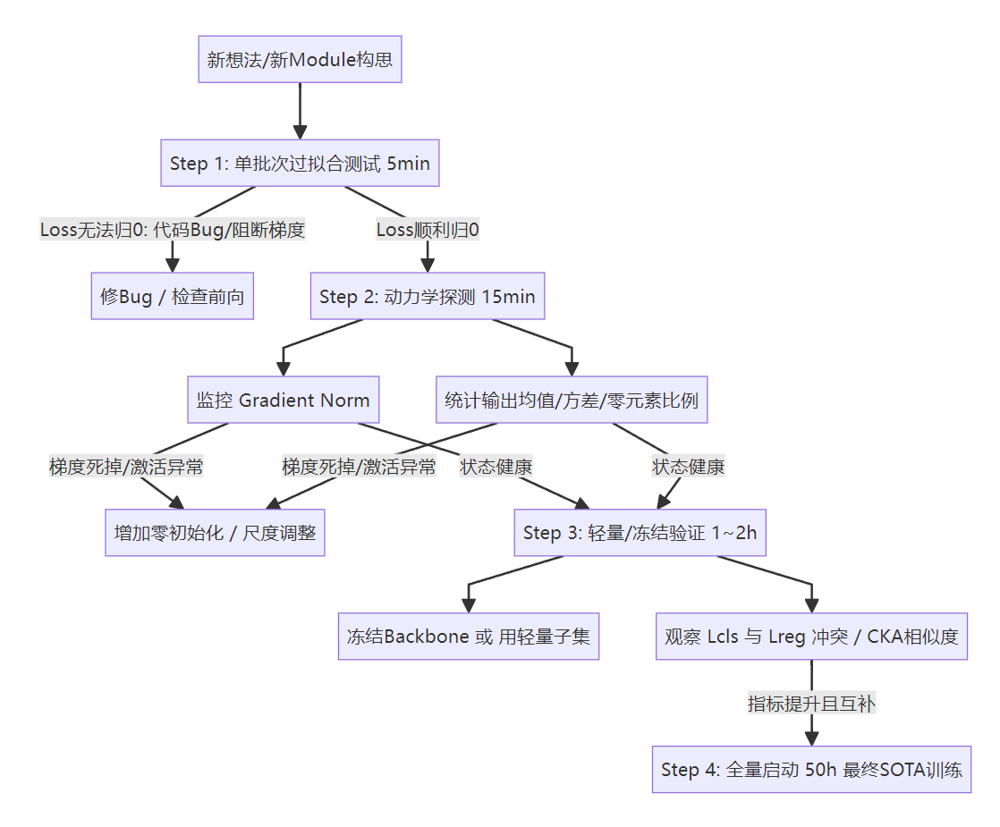
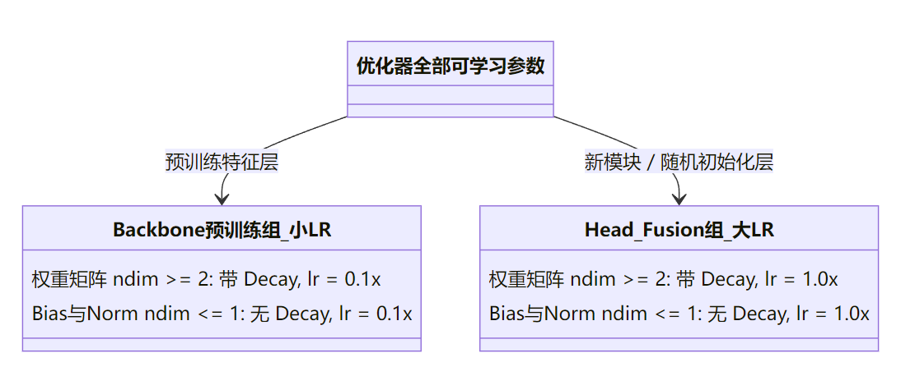
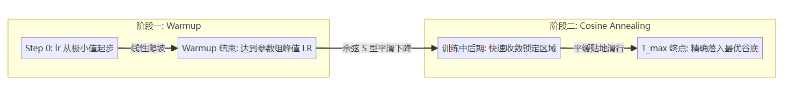

# Alchemy

记录自己的一些深度学习炼丹技巧

## 第一部分：如何高效做深度学习实验？（How to do experiment efficiently with deep learning?）

### 1. 高效排错与验证流程（1~8 步）

1. **单批次过拟合测试**（极速验证代码是否存在低级 Bug）。
2. **对新 Module 使用梯度范数监测**，查看是否发生梯度弥散或梯度爆炸。
3. **统计新 Module 输出的均值、方差以及“0”元素的比例**。
4. **CKA (Centered Kernel Alignment) 特征相似度分析**：用 CKA 分析加入 Module 前后的 Feature Map。
5. **$\mathcal{L}_{cls}$ 与 $\mathcal{L}_{reg}$ 观察分析**：查看是否发生“任务冲突”（Gradient Conflict），一般表现为 $\mathcal{L}_{cls} \downarrow$ 但 $\mathcal{L}_{reg} \uparrow$。
6. **类似 YOLO 训练完成后的可视化**：最终训练结果分析，如混淆矩阵（Confusion Matrix）等。
7. **使用 CAM 热力图分析**（验证注意力是否聚焦在目标区域）。
8. **若改进的是“Neck”与“Detection Head”**：可以直接冻结 Backbone 的预训练权重，只训练 Neck / Head。

#### 流程图：高效实验敏捷验证漏斗

---

### 2. 模块与模型改进的核心准则

* **“对模块”采用 0 初始化 $\to$**
  1. **分层学习率参数组**。
  2. **对 Plug and Play（即插即用模块）采用“零初始化”**。
  3. **对于 Transformer**：因缺乏归纳偏置，必须依赖 **AdamW**、**Grad Clip（梯度裁剪）**以及**更长的 Warmup**。
  4. **对于新做的改进**：审查是否存在**梯度流**和**尺度（Scale）**问题。
  5. **对模块零初始化时，只对该模块的最后一层权重和偏置置0或者使用ReZero在末尾乘上一个初始为0的可学习标量**，$$y = x + \alpha \cdot \text{NewModule}(x), \quad \text{其中 } \alpha \text{ 初始设为 } 0$$

---

## 第二部分：参数分组与权重衰减（Weight Decay 过滤规则）

### 1. 分层学习率参数组定义

* **定义**：根据网络不同层级所处的状态，分配不同的学习率和权重衰减（Weight Decay）。
* **把新 Module 放到“大学习率”参数组中**（基准学习率 $1.0\times$）。
* **Weight Decay 的数学本质**：会强制要求每轮更新参数时，强制把参数往“0”的方向拽一下。
* **铁律**：对偏置（Bias）、归一化层（Norm）以及嵌入编码表示（Embed）**不要进行 Weight Decay**。

### 2. 经典 $2 \times 2 = 4$ 参数组分类

* **按维度判定是否加 Weight Decay**：
  * **维度 $\ge 2$ 的参数**：
    * 卷积核为 4 维：$(C_{out}, C_{in}, K_h, K_w)$
    * 全连接权重为 2 维：$(C_{out}, C_{in})$
    * **角色**：核心权重矩阵 $\to$ **必须加 Weight Decay**。
  * **维度 $\le 1$ 的参数**：
    * Bias 只有 1 维
    * LayerNorm / BatchNorm 的 Scale 和 Bias 都只有 1 维
    * **角色**：阈值和尺度 $\to$ **一律不加 Weight Decay**。

#### 架构图：$2 \times 2 = 4$ 组参数分配矩阵

---

## 第三部分：学习率调度与 LayerNorm 底层拆解（第 2 页）

### 1. 学习率调度策略（Learning Rate Scheduler）

* **架构模式**：**Warmup（热身预热） + Cosine Annealing（余弦退火）**
  * $\text{Warmup} \longrightarrow \text{余弦退火}$
* **参数组中设置的学习率算什么？**
  * 分层学习率参数组中的学习率为**峰值学习率**（即 Warmup 上升到的最大基准学习率）。
* **实验时一定要注意**：
  * **退火的终点（退火周期 $T_{max}$）必须精确匹配到训练结束的那一刻！**
* **经验点拨**：至于收敛慢问题，总是得靠调参快速试错就明白了。

#### 曲线图：学习率在时间维度上的演变

---

### 2. 深入理解归一化层：LayerNorm 公式与参数本质

* **前向传播公式**：
  $$y = \gamma \cdot \left( \frac{x - \mu}{\sqrt{\sigma^2 + \epsilon}} \right) + \beta$$

* **公式逐项拆解**：
  * $\mathbf{\gamma}$（代码中的 `weight`）：
    * **Scale（缩放因子）**，负责通道维度的尺度缩放，可以认为是 Weight。
    * *为什么不加 Weight Decay*：若衰减压向 0，整个层输出全被抹除，特征信号断流。
  * $\mathbf{\frac{x - \mu}{\sqrt{\sigma^2 + \epsilon}}}$：
    * 归一化核心项：保证输入特征的均值变为 0（$x\text{'s mean is } 0$），方差变为 1（$x\text{'s variance is } 1$）。
  * $\mathbf{\beta}$（代码中的 `bias`）：
    * **Shift（平移因子）**，全新的偏移量，可以认为是 Bias。
    * *为什么不加 Weight Decay*：仅负责激活门槛平移，压向 0 无正则化意义，反伤模型容量。

